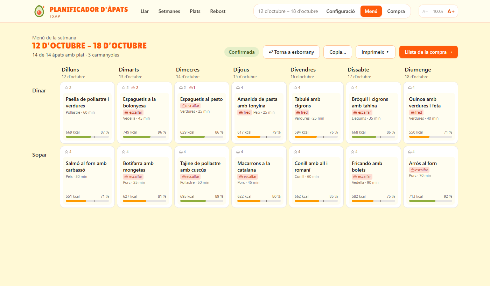

# Planificador d'àpats — Weekly Family Meal Planner

Plans a family's weekday lunches and dinners, Monday to Friday — including the ones that go to work in a lunchbox — entirely on your own computer.



## Start and stop with a double click (Windows)

For people who don't use a terminal.

- **`Instal·lar.bat`** — run once per computer. Enables WSL 2 / Virtual Machine Platform, installs Docker Desktop with winget, and checks that CPU virtualization is on. Asks for administrator rights and usually a restart.
- **`Engegar.bat`** — starts Docker Desktop if needed, starts the app and opens it in the browser. The first time takes a few minutes because it builds the app.
- **`Aturar.bat`** — stops the app. The data is kept for the next time.
- **`Guardar dades.bat`** — saves all the data to a file in `copies-de-seguretat\`. Copy that file to move the data to another computer. `Engegar.bat` also saves an automatic copy before every start (the last 10 are kept), since a new version of the app may upgrade the database.
- **`Recuperar dades.bat`** — loads a saved copy, replacing the current data (which is saved first). Drag a `.dump` file onto it, or double-click it to load the most recent copy. Copies from older versions are upgraded on start.

Tip: right-click each file → *Send to* → *Desktop (create shortcut)* to have them on the desktop.

## Quick start

```sh
docker compose up
```

Then open <http://localhost:3000>. The first launch creates the database, runs the migrations and seeds the recipe catalogue. All data lives in the `pgdata` Docker volume, so it survives `docker compose down` and restarts (only `docker compose down -v` deletes it).

| Service | URL |
| --- | --- |
| Web app | <http://localhost:3000> |
| API + OpenAPI UI | <http://localhost:8080/api/docs> |
| PostgreSQL | `localhost:5432`, database/user/password `mealplanner` |

## Development workflow

Run only the database in Docker, the API from your IDE and the frontend with Vite's dev server, for hot reload and debugging:

```sh
# 1. Database (same named volume as the full stack)
docker compose up db

# 2. API on :8080 — or run ApiApplication from the IDE. Defaults point at localhost:5432.
cd api
./gradlew bootRun

# 3. Frontend on :5173 with hot reload; /api is proxied to :8080
cd web
npm install
npm run dev
```

Tests:

```sh
cd api && ./gradlew test     # domain unit tests + Testcontainers integration tests (needs Docker)
# Without Docker, point the integration tests at an existing PostgreSQL (they wipe it):
TEST_DB_URL=jdbc:postgresql://localhost:5432/mealplanner_test ./gradlew test
cd web && npm run lint && npm run build
```

## What it does

1. **Setup wizard** — the household and its members: name, diet, allergies and intolerances.
2. **Week configuration** — which weekday lunches and dinners to plan and, for each one, who eats at home and who takes a lunchbox.
3. **Menu board** — a generated, balanced week that can be rearranged by dragging dishes, replaced from a filtered picker, or locked before regenerating. Dishes that do not survive a lunchbox are never placed in a meal with lunchbox diners, and the API rejects such assignments too. Once every meal has a dish the week can be confirmed. The menu prints as a one-page grid with who eats at home, who takes a lunchbox and who is away, and each dish on the board has a print icon for its recipe sheet.
4. **Dishes** — the recipe catalogue: name, servings, time, main protein, whether it also works in a lunchbox, ingredients and steps; the family can add their own dishes and ingredients, and hide the ones they don't want proposed.

## Architecture

```
/api   Spring Boot 4.1 (Java 21), PostgreSQL, Flyway, springdoc-openapi
/web   React + TypeScript + Vite, TanStack Query, dnd-kit, Tailwind CSS
/docs  Design notes and decision log
```

All domain logic (assignment rules, unit conversion, recipe facts such as allergens and diets, and the menu generator) lives in plain Java classes under `app.mealplanner.domain`, with no Spring or JPA. They take data in and return data out, and are unit-tested without a Spring context or a database; `DomainPurityTest` fails the build if a domain class imports Spring, JPA or the application layers. Controllers, services and repositories (`web`, `application`, `persistence`) are a thin layer that maps HTTP and persistence onto that domain.

The menu generator (`domain.generator.MenuGenerator`) is rules plus scoring: hard constraints filter the catalogue per meal (lunchbox, allergies, diet), survivors are scored on protein rotation, variety and recency, and one of the top five is drawn at random. The scoring is explained at the top of the class.

The API is documented with OpenAPI at `/api/docs`. Errors are RFC 9457 problem details with a machine-readable `code` and, for business rule violations, human-readable `reasons`.

See [docs/decisions.md](docs/decisions.md) for the decisions taken along the way.
